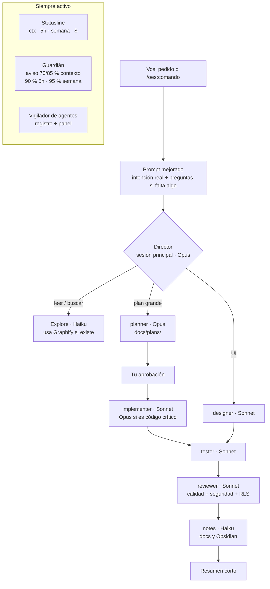

# OES-Studio-skill

**Plugin para Claude Code (Windows) que convierte una sesión en un equipo de trabajo organizado.** Opus piensa, Sonnet programa y Haiku lee. Incluye flujos automáticos, comandos cortos `/oes:` y control del consumo y del contexto.

Creado por Michael Hofer · [Obsidian Edge Studio](#créditos) · Licencia MIT

---

## Finalidad

Trabajar proyectos grandes con Claude Code sin quedarse sin uso a mitad del día y sin perder calidad:

- **Gastar menos sin perder calidad.** Cada tarea la hace el modelo justo. Opus se reserva para pensar y para el código crítico.
- **No repetir instrucciones.** El mismo flujo en todos los proyectos: prompt mejorado, plan, aprobación, código, pruebas, revisión.
- **No perder el hilo.** Cuando se acerca un límite, se corta en un buen punto y queda guardado dónde seguir.
- **Ver qué pasa.** Una statusline muestra contexto, ventana de 5 h, semana y costo. Hay informes de consumo y un panel de agentes en vivo.
- **Instalar sin duplicar.** Antes de instalar se audita lo que ya tenés, y vos decidís qué queda y qué se va.

## Cómo funciona



El plugin trabaja en 4 capas:

| Capa | Qué hace | Dónde vive |
|---|---|---|
| **Skill `oes-studio`** | Reglas de trabajo: quién hace qué, flujo, diseño, Graphify, consumo | `plugin/skills/oes-studio/` |
| **Skill `consejo`** | Consejo de asesores para decisiones | `plugin/skills/consejo/` |
| **Agentes** | 10 subagentes con su modelo y sus permisos (7 de trabajo + 3 del consejo) | se copian a `~/.claude/agents/` |
| **Comandos** | 23 atajos `/oes:` para tareas frecuentes | `plugin/commands/` |
| **Hooks y scripts** | Statusline, avisos de contexto y límites, registro de agentes, auditoría | `plugin/hooks/`, `plugin/scripts/` |

### Equipo y modelos

| Agente | Modelo | Trabajo |
|---|---|---|
| Sesión principal | Opus | Entender, decidir, planificar, resolver bugs difíciles |
| `planner` | Opus | Planes de features, refactors y arquitectura |
| `Explore` | Haiku | Buscar y leer el repo (reemplaza al Explore de fábrica, que usaría Opus) |
| `implementer` | Sonnet (Opus en código crítico) | Escribir y editar código |
| `reviewer` | Sonnet | Bugs, seguridad, Supabase/RLS |
| `designer` | Sonnet | Páginas, UI y animación |
| `tester` | Sonnet | Tests, pruebas E2E con Playwright y build roto |
| `notes` | Haiku | Docs y notas de Obsidian |
| Consejo: `consejero` ×5, `revisor-consejo` ×5, `presidente` | Sonnet, Haiku, Opus | Decisiones importantes (ver abajo) |

Se considera **código crítico**: auth, pagos y suscripciones, migraciones y RLS, concurrencia, sincronización de stock en tiempo real, algoritmos complejos, o cuando Sonnet falló 2 veces en lo mismo.

### Flujo automático de cada tarea

1. **Prompt mejorado.** Reescribe tu pedido con la intención real y pregunta solo si falta algo importante.
2. **Contexto.** `Explore` consulta el grafo de Graphify, o el repo si no hay grafo.
3. **Plan.** En tareas medianas o grandes, `planner` escribe `docs/plans/…` y **espera tu aprobación**.
4. **Implementación.** `implementer` trabaja por fases, en paralelo cuando se puede.
5. **Verificación.** `tester` corre build, lint y tests. Si hay UI, `designer` saca capturas.
6. **Revisión.** `reviewer` revisa el diff. Lo crítico se arregla antes de cerrar.
7. **Cierre.** Resumen corto y `docs/estado.md` actualizado. Commit solo si lo pedís.

Las respuestas van en **modo cavernícola**: solo lo importante, sin narrar pasos.

### El consejo

Para decisiones con algo en juego, como "¿cobro mensual o anual en Nodelier?" o "¿migro a otro stack?". Se basa en el método LLM Council de Andrej Karpathy, en la versión para Claude de Ole Lehmann:

1. **5 asesores en paralelo**, cada uno con un enfoque: el Contrario (qué va a fallar), Primeros principios (qué se resuelve de verdad), el Expansionista (qué potencial no se ve), el de Afuera (qué no entiende alguien sin contexto) y el Ejecutor (qué se hace el lunes).
2. **Revisión cruzada anónima**: las respuestas se mezclan como A-E y 5 revisores eligen la más sólida, el mayor punto ciego y lo que se les pasó a todas.
3. **El presidente (Opus) da el veredicto**: dónde coinciden, dónde chocan, puntos ciegos, una recomendación sin "depende" y un único primer paso.
4. Todo queda guardado en `docs/consejo/`.

Tiene 3 modos: `rapido` (3 asesores, sin revisión), `normal` y `profundo` (con datos del proyecto e investigación web). Antes de decisiones caras, Claude lo propone; no lo ejecuta solo.

Límite: los asesores son el mismo modelo con distinto enfoque. Reduce el "decirte que sí", pero no reemplaza tu criterio.

## Comandos

| Comando | Para qué sirve |
|---|---|
| `/oes:ayuda` | Lista de comandos |
| `/oes:setup` | Instala o actualiza todo, con auditoría previa y sin duplicar |
| `/oes:auditar` | Analiza plugins, skills, conectores, agentes, hooks y configuración: útil, neutro, conviene quitar, duplicado o falta |
| `/oes:proyecto` | Crea la estructura OES en el proyecto (y Graphify si es grande) |
| `/oes:feature` | Funcionalidad nueva: plan, aprobación, código, pruebas y revisión |
| `/oes:bug` | Reproduce el error, busca la causa raíz, escribe un test y aplica el arreglo mínimo |
| `/oes:diseno` | Diseño de página o app en 3 fases: diagnóstico, plan y tu aprobación, implementación |
| `/oes:dato` | Guarda un dato o información donde corresponde |
| `/oes:idea` | Registra una idea y analiza su viabilidad con puntaje y veredicto |
| `/oes:consejo` | Consejo de 5 asesores: analizan por separado, se revisan en forma anónima y un presidente da el veredicto |
| `/oes:resumen` | Resumen completo: hecho, por hacer, ideas, recomendaciones y lo que tenés que hacer vos |
| `/oes:analisis` | Busca errores, qué mejorar, qué perfeccionar y qué quitar |
| `/oes:opinion` | Opinión neutral con datos del proyecto e investigación del mercado |
| `/oes:social` | Medio para redes: estrategia, estilo y un equipo que busca tendencias, crea videos y los publica |
| `/oes:commit` | Revisa el diff y hace commit convencional (push opcional) |
| `/oes:deploy` | Deploy en Vercel: preview directo, producción solo con tu confirmación |
| `/oes:limite` | Corta en el mejor punto antes del límite y guarda el traspaso |
| `/oes:continuar` | Retoma desde el último traspaso |
| `/oes:consumo` | Uso de la ventana de 5 h y de la semana, y costo por día, modelo y proyecto |
| `/oes:contexto` | Qué ocupa el contexto y cómo liberarlo |
| `/oes:agentes` | Qué subagentes trabajaron, con tokens y tiempo |
| `/oes:panel` | Panel visual de agentes en vivo (`start`, `stop`, `status`) |
| `/oes:nota` | Convierte contenido en notas de Obsidian |

Detalle de cada comando, con lo que hace y los archivos que genera: **[docs/COMANDOS.md](docs/COMANDOS.md)**.

## Instalación (Windows)

**Requisitos:** Windows 10 u 11 y una cuenta de Claude (Pro o Max). Todo lo demás se instala en los pasos.

Usá **PowerShell normal**, desde el menú Inicio y sin "Ejecutar como administrador". El prompt tiene que mostrar `C:\Users\<tu usuario>`, no `C:\Windows\system32`.

Se escribe en dos lugares distintos:
- **PowerShell:** `winget`, `gh`, `claude plugin …`.
- **Claude Code:** se abre escribiendo `claude` en PowerShell. Los comandos que empiezan con `/`, como `/oes:setup`, van acá. En PowerShell dan error.

1. **Herramientas** (PowerShell). Instalá Node y Git **antes** que el plugin: sus hooks usan Node desde el primer arranque.
   ```powershell
   "Git.Git","OpenJS.NodeJS.LTS","astral-sh.uv","GitHub.cli","Oven-sh.Bun" | % { winget install -e --id $_ --accept-source-agreements --accept-package-agreements }
   ```
2. **Claude Code** (PowerShell). Si ya lo tenés en la terminal, saltá este paso. La app de escritorio de Claude no agrega el comando `claude` a PowerShell.
   ```powershell
   irm https://claude.ai/install.ps1 | iex
   ```
3. **Cerrá PowerShell, abrí una nueva y comprobá:**
   ```powershell
   node --version; git --version; claude --version
   ```
   Tienen que aparecer las tres versiones. Si `claude` no se reconoce, mirá [Problemas frecuentes](#problemas-frecuentes).
4. **GitHub** (PowerShell): `gh auth login`, y elegí GitHub.com → HTTPS → Login with a web browser.
5. **Ver qué ya tenés** (PowerShell): `claude plugin list`. Si tu cuenta sincroniza plugins desde claude.ai, aparecen con `@synced`: anotalos. Si aparece `oes@synced`, saltá el paso 6.
6. **Plugin OES** (PowerShell):
   ```powershell
   claude plugin marketplace add Esyrium12/OES-Studio-skill
   ```
   ```powershell
   claude plugin install oes@oes-studio
   ```
7. **Setup** (Claude Code). Escribí `claude` y, adentro, `/oes:setup`. La primera vez Claude Code te pide el tema, iniciar sesión y confiar en la carpeta.
   - Muestra la auditoría y pregunta qué quitar, qué no instalar y si querés el panel de agentes (recomendado: sí).
   - **Qué no instalar:** marcá lo que en el paso 5 apareció con `@synced`. Si no apareció nada, no marques nada.
   - Si abriste Claude Code en tu carpeta de usuario, los "duplicados" que muestra son falsos: no quites nada.
   - Instala solo lo que falta, en unos minutos, y muestra una tabla con el resultado.
8. **Reiniciá Claude Code:** `/exit` y después `claude`.
9. **Supabase y Vercel** (Claude Code): `/mcp`, entrá a cada uno y elegí **Authenticate**.
10. **Claves opcionales.** Cargalas como variables de entorno, nunca en el chat:
    ```powershell
    setx FIRECRAWL_API_KEY "tu-clave"     # leer webs y comparar con la competencia
    setx ELEVENLABS_API_KEY "tu-clave"    # voz para /oes:social
    ```
    Después reiniciá la terminal y Claude Code, y repetí `/oes:setup`.
11. **Comprobar que quedó bien:**
    - Abajo aparece la statusline: `Opus │ ctx ███░░ 30% │ 5h 12% │ sem 4% │ $0.40`.
    - En Claude Code, `!ls ~/.claude/agents` muestra los 10 agentes de OES: `Explore`, `planner`, `implementer`, `reviewer`, `designer`, `tester`, `notes`, `consejero`, `revisor-consejo` y `presidente`. Las versiones nuevas de Claude Code ya no tienen `/agents`. Si instalaste impeccable, también aparecen sus agentes `impeccable-…`.
    - `/oes:ayuda` muestra los comandos, incluido `/oes:consejo`.
    - Al terminar cada respuesta no aparece "Stop hook failed".
12. **En cada proyecto:** abrí PowerShell en la carpeta del proyecto, escribí `claude` y, la primera vez, `/oes:proyecto`.

**Actualizar** (PowerShell):
```powershell
claude plugin marketplace update oes-studio
```
```powershell
claude plugin update oes@oes-studio
```
Después abrí Claude Code y corré `/oes:setup`: saltea lo que ya está y copia los agentes nuevos.

### Problemas frecuentes

**`claude` no se reconoce en PowerShell.** Instala Claude Code si falta y agrega su carpeta al PATH de tu usuario. Después cerrá y abrí PowerShell:
```powershell
if (-not (Test-Path "$env:USERPROFILE\.local\bin\claude.exe")) { irm https://claude.ai/install.ps1 | iex }; $p = [Environment]::GetEnvironmentVariable('Path','User'); if ($p -notlike "*\.local\bin*") { [Environment]::SetEnvironmentVariable('Path', "$p;$env:USERPROFILE\.local\bin", 'User') }
```

**`/oes:setup` no se reconoce.** Lo escribiste en PowerShell. Primero abrí Claude Code con `claude` y escribilo adentro.

**`Stop hook failed … impeccable: no engine binary for windows-x64`.** impeccable no bajó su programa para Windows. En PowerShell, con `gh` ya logueado:
```powershell
$d = "$env:USERPROFILE\.impeccable\bin"; New-Item -ItemType Directory -Force $d | Out-Null
$t = (gh release list -R pbakaus/impeccable --limit 50 | Select-String 'engine-v[\d.]+' | Select-Object -First 1).Matches[0].Value
gh release download $t -R pbakaus/impeccable -p "*windows-x64*" -D $d --clobber
Get-ChildItem $d -Filter "*windows-x64*" | Where-Object { $_.Extension -in '','.exe' } | Select-Object -First 1 | Move-Item -Destination "$d\impeccable.exe" -Force; Get-ChildItem $d
```
Tiene que quedar `impeccable.exe` en esa carpeta.

**La auditoría marca duplicados y estás en `C:\Users\<tu usuario>`.** Es falso: ahí la carpeta "de proyecto" y la "de usuario" son la misma, así que cada skill se cuenta dos veces. No quites nada.

**La auditoría marca como "falta" algo que `claude plugin list` muestra con `@synced`.** Ya lo tenés, desde claude.ai. Elegí no instalarlo para no duplicarlo.

**Cuadro de claude-mem con "30 Day Free Trial".** Es su servicio pago, y es opcional. La memoria funciona gratis en tu PC, y el cuadro desaparece cuando guarda su primer recuerdo.

**Desinstalar:**
- `/plugin uninstall oes@oes-studio`.
- Borrar los 10 agentes de `~/.claude/agents/`.
- Borrar el bloque `<!-- OES:START … OES:END -->` de `~/.claude/CLAUDE.md`.
- Borrar `statusLine` de `~/.claude/settings.json`.
- Borrar la carpeta `~/.claude/oes/`.

## Qué instala

| Tipo | Elementos |
|---|---|
| Conectores | Supabase, Vercel y Context7 (vienen en el plugin), Playwright (plugin oficial), Firecrawl (solo si hay clave). GitHub vía `gh` |
| Plugins | caveman, claude-mem, claude-code-setup, frontend-design, figma, playwright |
| Skills | impeccable (con hook de diseño), las de Emil Kowalski (emil-design-eng, animate, review-animations, improve-animations, find-animation-opportunities, apple-design, mobile-native, break-ui, animation-vocabulary, pick-ui-library), Supabase agent-skills, Graphify |
| Configuración | Bloque OES en `~/.claude/CLAUDE.md` (lo tuyo se conserva), reglas de código en `~/.claude/rules/oes/`, statusline |

Todo lo que se reemplaza queda en `~/.claude/oes/backup/`.

## Estructura

```
OES-Studio-skill/
├── .claude-plugin/marketplace.json   # marketplace "oes-studio"
├── plugin/
│   ├── .claude-plugin/plugin.json    # plugin "oes"
│   ├── .mcp.json                     # Supabase, Vercel, Context7
│   ├── skills/oes-studio/            # skill principal + referencias (modelos, diseño, Obsidian, herramientas)
│   ├── skills/consejo/               # consejo de asesores
│   ├── agents-templates/             # 10 agentes
│   ├── commands/                     # 23 comandos /oes:
│   ├── hooks/hooks.json              # inicio de sesión, prompt, agentes, cierre
│   ├── scripts/                      # statusline, guardián, vigilador, auditoría, informes, setup.ps1, panel.ps1
│   ├── templates/                    # CLAUDE.md global y de proyecto, docs, equipo social
│   ├── rules/oes-reglas.md           # reglas de código (destiladas de ECC)
│   └── ecc-reference/                # reglas originales de ECC (MIT), solo de consulta
└── docs/COMANDOS.md
```

Cada proyecto queda así: `CLAUDE.md` corto, más `docs/` con `plans/`, `decisiones.md`, `estado.md`, `datos.md`, `ideas/`, `consejo/`, `analisis/`, `opinion/`, `resumen.md` y `handoff.md`, más `social/` si usás redes.

## Privacidad y seguridad

- Los scripts propios solo escriben en `~/.claude/oes/` en tu PC y no envían datos afuera.
- El panel de agentes corre en `localhost`.
- Las claves van en variables de entorno, nunca en archivos ni en el chat.
- Preguntan antes de actuar: borrar datos, migraciones o deploy a producción, push forzado, instalar o quitar herramientas, publicar en redes (salvo que actives el modo autónomo).
- `/oes:social` no re-sube contenido ajeno y etiqueta el contenido IA realista.

## Limitaciones

- Está pensado para **Windows**. Los scripts en Node funcionan en cualquier sistema; el instalador es PowerShell.
- En **Claude Code en la nube** (sección Code de la app o claude.ai/code), el plugin sincronizado desde claude.ai carga los comandos `/oes:`, las skills y los hooks. `/oes:setup` no corre ahí (no hay PowerShell), así que faltan los 10 agentes, las skills y plugins extra, y la statusline. Además, cada sesión empieza en un contenedor nuevo.
- El modo cavernícola ahorra poco por sí solo. Lo que más ahorra es delegar la lectura a `Explore` (Haiku), Graphify y compactar a tiempo.
- TikTok solo publica en privado hasta que su API apruebe tu app. Instagram necesita cuenta profesional.
- El costo que muestra la statusline con suscripción Pro/Max es "equivalente API": sirve para comparar, no es lo que pagás.

## Créditos

- Consejo: método [LLM Council](https://github.com/karpathy/llm-council) de Andrej Karpathy, en la versión para Claude de [Ole Lehmann](https://github.com/aiwithremy/claude-skills-llm-council) (reescrita en español).
- Reglas de código destiladas de [Everything Claude Code (ECC)](https://github.com/affaan-m/ECC), MIT, Affaan Mustafa.
- Panel de agentes: [disler/claude-code-hooks-multi-agent-observability](https://github.com/disler/claude-code-hooks-multi-agent-observability).
- Herramientas que instala: [caveman](https://github.com/JuliusBrussee/caveman), [claude-mem](https://github.com/thedotmack/claude-mem), [Graphify](https://github.com/safishamsi/graphify), [impeccable](https://github.com/pbakaus/impeccable), [skills de Emil Kowalski](https://github.com/emilkowalski/skills), [Supabase agent-skills](https://github.com/supabase/agent-skills).

## Licencia

MIT. Ver [LICENSE](LICENSE).
